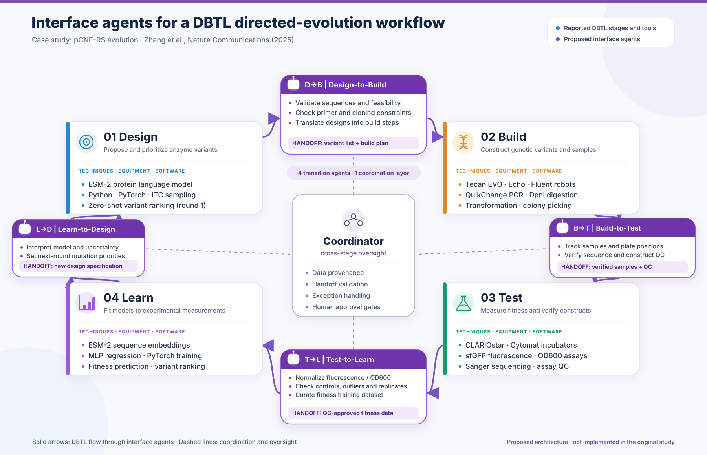

# Interface Agents for a DBTL Directed-Evolution Workflow

## Goal

Explore how **four specialized AI agents at the interfaces** between Design, Build, Test, and Learn (DBTL) could coordinate a directed-evolution campaign. The agents do **not** replace the biological experiments or prediction models; they validate information, manage handoffs, detect problems, and preserve traceability between stages.

**Case study:** Zhang et al. (2025), *Nature Communications*, [Integrating protein language models and automatic biofoundry for enhanced protein evolution](https://www.nature.com/articles/s41467-025-56751-8). The study evolved a tRNA synthetase over **four DBTL rounds in 10 days**, testing **96 variants per round** and reporting **up to 2.4× improved activity**.

## DBTL stages: methods and equipment

| Stage | Main techniques, software, or equipment | Output |
|---|---|---|
| **Design** | ESM-2 protein language model, zero-shot mutation ranking, Python/PyTorch | Candidate enzyme variants |
| **Build** | Site-directed mutagenesis (PCR, DpnI), bacterial transformation, automated liquid handling (Tecan EVO/Echo/Fluent) | Constructed and tracked variant library |
| **Test** | Cell cultivation, fluorescence/OD600 assays, CLARIOstar plate reader, Cytomat incubators, Sanger sequence verification | Experimental measurements and QC records |
| **Learn** | ESM-2 sequence representations, multilayer perceptron (MLP), supervised fitness prediction, PyTorch | Updated model and next-round predictions |

Equipment and methods above refer to the **published experimental workflow**; allocation to interfaces below is **our proposal**.

## Proposed interface agents

| Interface | Agent responsibilities | Handoff |
|---|---|---|
| **Design → Build** | Validate selected sequences, check feasibility and primer requirements | Variant list, design specifications, build plan |
| **Build → Test** | Verify sample identity, sequence confirmation, construction quality and assay readiness | Sample/plate maps, verified constructs, QC status |
| **Test → Learn** | Normalize and curate measurements; check controls, replicates, outliers and missing data | Validated fitness dataset and metadata |
| **Learn → Design** | Interpret model results and uncertainty; prioritize mutations and next-round constraints | Updated design objectives and candidate priorities |

A **Coordinator** maintains cross-stage provenance, tracks exceptions and requests human approval at key decision points. The **human researcher** defines the objective and retains scientific oversight.

## Architecture diagram

## References

- [Zhang et al. (2025), *Nature Communications*](https://www.nature.com/articles/s41467-025-56751-8) — experimental DBTL case study; [PLMeAE code](https://github.com/HICAI-ZJU/PLMeAE).
