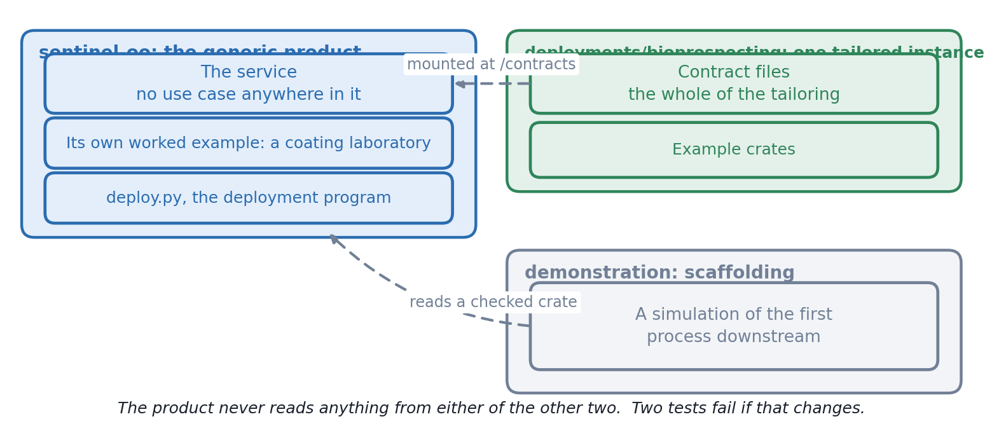
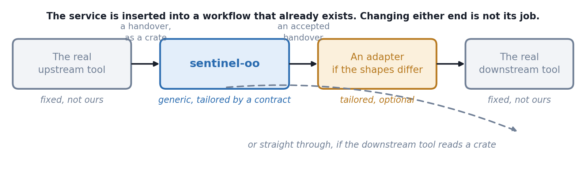
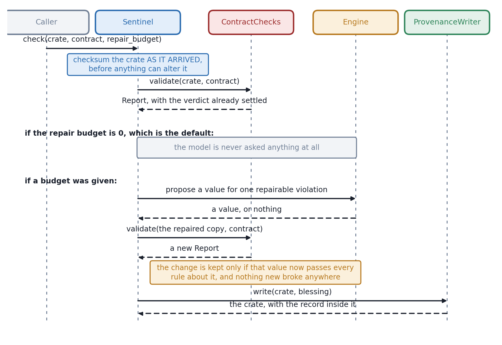
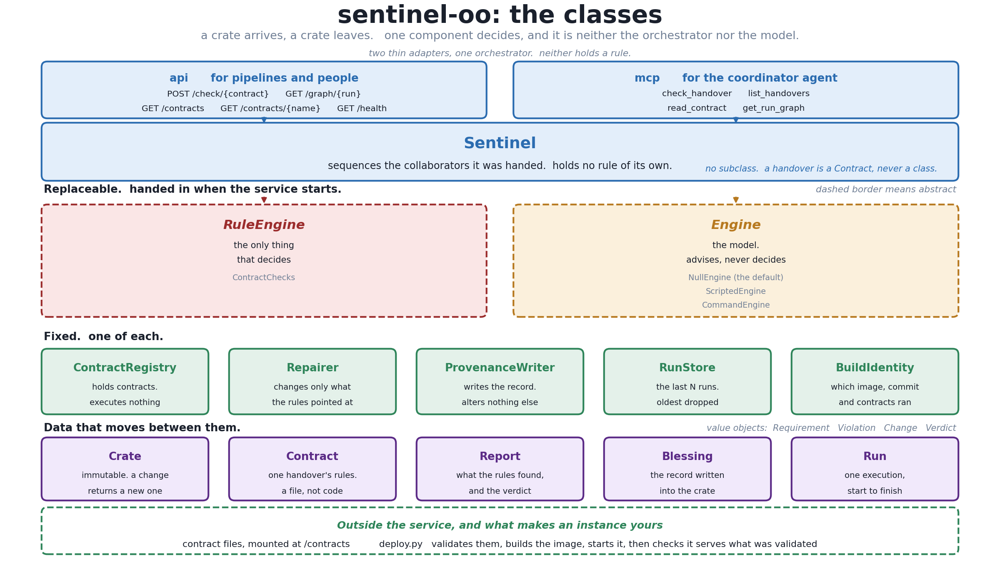
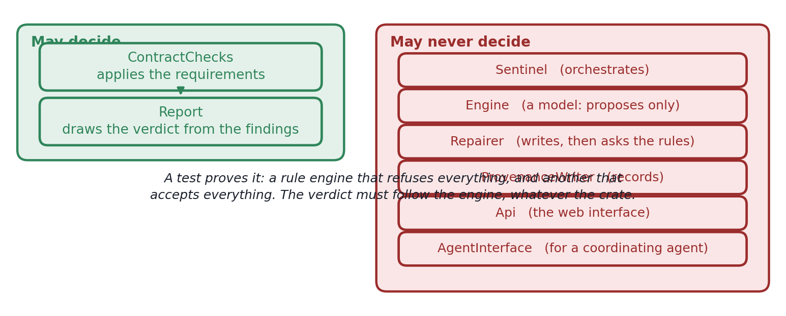
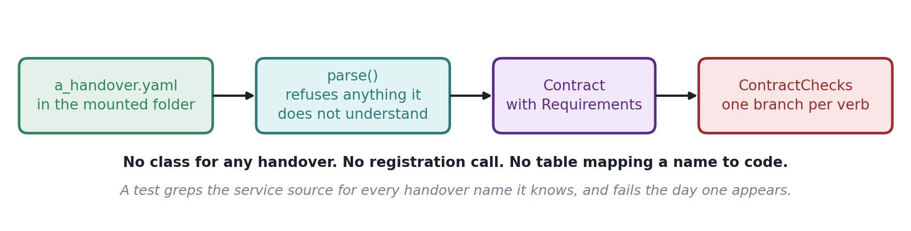
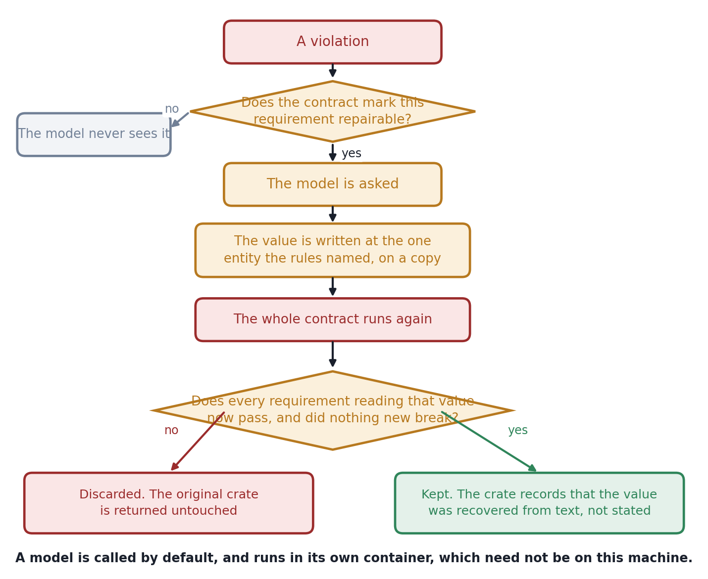
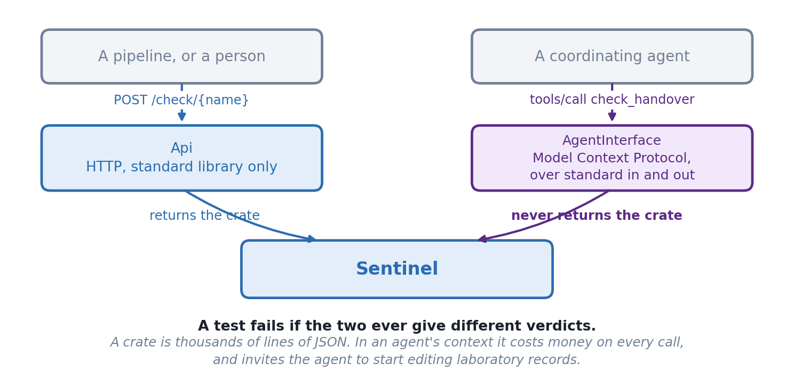
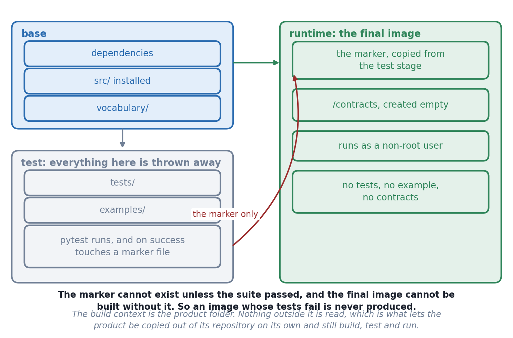
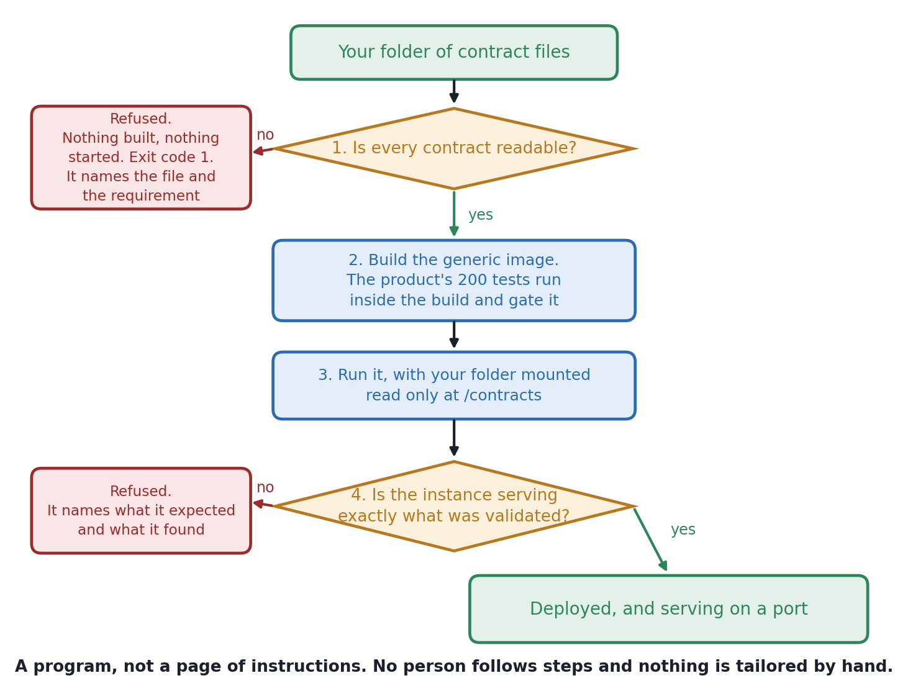

# sentinel-oo: system manual

What the system is, how it is put together, and why it is put together that
way. Written for somebody who is going to change it, review it, or decide
whether to adopt it.

If you only want to use it, read [the user manual](USER_MANUAL.md) instead.

**The diagrams are drawn images**, so they appear in every viewer and in the
PDF. They are generated by `diagrams/make_diagrams.py`, so a diagram that
goes out of date is a script to edit rather than a picture to redraw.

---

## Contents

1. [What it decides](#1-what-it-decides)
2. [Three separate things](#2-three-separate-things)
3. [How one check flows](#3-how-one-check-flows)
4. [The components](#4-the-components)
5. [Where a decision may be made](#5-where-a-decision-may-be-made)
6. [A contract is data, not code](#6-a-contract-is-data-not-code)
7. [The model, and what it is not allowed to do](#7-the-model-and-what-it-is-not-allowed-to-do)
8. [The record written into the crate](#8-the-record-written-into-the-crate)
9. [The two ways in](#9-the-two-ways-in)
10. [The container](#10-the-container)
11. [A deployment](#11-a-deployment)
12. [The invariants, and the tests that hold them](#12-the-invariants-and-the-tests-that-hold-them)
13. [Known limitations](#13-known-limitations)
14. [Acknowledgements](#acknowledgements)

---

## 1. What it decides

A **handover** is the moment one phase of work passes its output to the next.
In a Design, Build, Test, Learn cycle there are four of them, and this is a
service that sits at one.

It answers exactly one question: **can the next phase act on what the
previous phase produced?**

A crate goes in and a crate comes out. The crate that comes out is the one
that went in, plus a record of what was checked, against which rules, by
which build of this service, with which model if any, and what was found.

A **crate** here means an RO-Crate: a folder of data files with a JSON file
alongside them describing what each file is and how the things in it relate
to one another.

### The three verdicts

| Verdict | What it means | What should happen next |
|---|---|---|
| `ACCEPTED` | Nothing was found | The next phase proceeds |
| `ACCEPTED_WITH_FLAGS` | Nothing stops the handover, but something was recorded | The next phase proceeds and something or somebody reads the flags |
| `REFUSED` | At least one requirement with severity `refuse` was violated | The next phase must not proceed |

### What it is not

It is not a validator. A third party tool, `rocrate-validator`, already
checks that the packaging is well formed, and this service does not duplicate
that.

**The distinction those two make is the whole point of the system.** A crate
can satisfy every rule a standard has and still be useless to the phase
receiving it. Measured on 10 November 2026 against five crates:

| Crate | `rocrate-validator` | `sentinel-oo` |
|---|---|---|
| The published example | valid | ACCEPTED |
| Profile declaration removed | valid | REFUSED |
| A gene calling setting removed | valid | REFUSED |
| A reference to a file it never describes | valid | REFUSED |
| The setting present, but only in prose | valid | REFUSED |

The last row is the one worth understanding. Nothing is missing from that
crate. The value is there, inside the text of a command line, where no rule
can read it. So a valid crate can be refused for being unreadable rather than
for being incomplete.

---

## 2. Three separate things

Keeping these apart is the central design decision, not a tidiness
preference.

| | What it is | Contains code? | Specific to a use case? |
|---|---|---|---|
| The product | The service and the deployment program | Yes, all of it | No |
| A deployment | Contract files and example data | No | Yes |
| The demonstration | A stand-in for the next real tool | Yes | Neither, it stands in for reality |

**Why it matters.** Somebody from another Design, Build, Test, Learn cycle
must be able to take the product on its own, write contract files for their
own handover, and deploy, without writing or editing any code. That is the
difference between a product and one team's project.

### What the arrows mean, and what they deliberately do not

The product never reads anything from a deployment or from the
demonstration. The dependency points one way only, and two tests fail if
that ever changes.

### The boundaries either side are fixed

The service is inserted into a workflow that already exists. The tool
upstream and the tool downstream are real, they are not ours, and changing
them is not this system's job.

An **adapter** converts an accepted crate into whatever the downstream tool
actually wants. It is tailored to one cycle, so it belongs to a deployment.
The current demonstration has no adapter, because the simulator reads the
crate directly, and that is a simplification: a real gene synthesis vendor's
ordering system would not read an RO-Crate.

---

## 3. How one check flows

### Three things about that order

**The checksum is taken of the crate as it arrived**, not at the end. Taken
later it would describe something the sender never sent, and a reader could
no longer tell whether what was blessed has since been altered.

**The verdict is settled when the report is constructed** and there is no way
to set it afterwards. `Sentinel` never looks at the findings to form a view
of its own; it carries the verdict across unchanged.

**A refusal still returns a crate.** A refusal that exists only as an error
message in somebody's terminal is not a record. The refused crate is the
artefact you want when asked in a year why a batch never went to synthesis.

---

## 4. The components

### What each one is for

| Component | Responsibility | May decide a verdict? |
|---|---|---|
| `Sentinel` | Orchestration. Calls the others in order and assembles the record | **No** |
| `Crate` | Reading, holding and writing an RO-Crate, immutably | No |
| `ContractRegistry` | Finding a contract by name and version | No |
| `Contract` and `Requirement` | What a handover must satisfy, read from a file | No |
| `ContractChecks` | Applying the requirements | **Yes, and only this** |
| `Report` | The findings and the verdict drawn from them | Yes, on construction |
| `Engine` | Asking a model one question. Advisory only | No |
| `Repairer` | Writing a proposed value and handing it back to the rules | No |
| `ProvenanceWriter` | Writing the record into the crate | No |

### The crate is immutable

Every operation that would change a crate returns a new one. Internally the
contents are frozen: dictionaries become read-only views and lists become
tuples, recursively.

That is not a style choice. The service receives data from somebody else,
judges it, and returns it. If it could edit what it was given in place, then
the thing it checksummed and the thing it returned would not provably be
related.

---

## 5. Where a decision may be made

This is the invariant the whole design is arranged around.

A test proves it by installing a rule engine that refuses everything and
another that accepts everything, and checking that the verdict follows the
engine in both cases regardless of the crate. If any crate is ever accepted
while the refusing engine is installed, something other than the rule engine
is deciding.

---

## 6. A contract is data, not code

Adding a handover means writing a file. There is no class for any handover,
no registration call, and no table mapping a name to code.

### The vocabulary is deliberately small

A requirement may demand exactly four things: `be recorded`, `be unique`,
`point at something in the crate`, `be a number between`. A contract may also
declare, with `expects`, which entity types it is written for.

The list is short on purpose. A language that can say anything can also say
things nobody can check, and this list is what a contract author can be shown
as the whole of their vocabulary.

### Nothing is silently ignored

The reader refuses a contract containing a field it does not recognise, a
verb it cannot check, a severity that is not one of the two, or a requirement
with no message. A silently ignored requirement is a requirement somebody
believes is protecting them.

**In particular there is no field for instructing a model**, and the error
message says so. This service accepts contracts from whoever is sending the
handover, so prompt text in a contract would mean the sender writing the
model's instructions.

---

## 7. The model, and what it is not allowed to do

### The one job

A rule can only read a value recorded as a value. If the same fact is present
in the crate but only inside a sentence of free text, no rule can see it, and
the handover is refused for a value that is physically there.

So the model is handed a check that has **already failed**, at a place the
rules named, and asked one question: is this value already written down
somewhere in this record, including inside prose?

Answering "no" is a correct and expected answer.

**Where this thinking comes from.** Most of this section is not new. The
`sentinel` framework, which Marco Anteghini wrote for Project 25 and which
sits beside this one in the same repository, settled what a model is for at
a handover, and that part of it is reproduced here almost unchanged. What
this design changes is how the service is structured, not what the model is
allowed to do. The specific debts are listed under
[Acknowledgements](#acknowledgements).

### What constrains it, all in code rather than in the prompt

Three further constraints:

**The default calls nothing.** The repair budget is 0 unless a caller asks
otherwise, so by default no model is contacted at all. A service with no
model configured refuses and accepts exactly as one with a model does.

**A proposal is applied only at the entity the rules named.** Without that, a
model asked about two slots claiming one position could answer by renaming a
slot. The re-check would genuinely pass, because renaming does make the name
unique, and a record of something that never happened would have been
written.

**The prompt is one fixed template.** Contract text fills labelled data slots
and never becomes an instruction.

### The fault this design caught

Originally the code checked only the requirement being repaired. A model
answered with a phrase that was not one of the permitted values. That
satisfied "the setting must be recorded" and failed "the setting must be one
of these", so the handover was correctly refused, **and the invented phrase
was written into the crate anyway.** A refusal carrying a fabrication is
worse than a plain refusal, because the fabrication outlives the refusal.

### What a real model actually did

Measured on 10 November 2026 with two models running locally through Ollama,
each with 14 billion parameters, where "14b" in a model's name means 14
billion parameters.

| Model | Given the real job | Asked what the flag means | Told the meaning, asked to apply it |
|---|---|---|---|
| `qwen2.5:14b` | recovered nothing | confidently wrong | answered the opposite of the truth |
| `qwen2.5-coder:14b` | recovered nothing | confidently wrong | answered correctly |

Every outcome through the service was a refusal with nothing written. Stub
models standing in for wrong answers were all discarded by the rules.

**What that establishes:** a model of this size does not know what a
bioinformatics tool's flag means and will state a wrong meaning without
hedging, and a model being wrong, absent or confidently mistaken changed no
verdict and wrote nothing. **What it does not establish:** that the recovery
path works with a real model, because no real model got it right while doing
the real job.

---

## 8. The record written into the crate

Everything the service did is written into the returned crate as RO-Crate
entities, so the crate carries its own history and needs no database beside
it.

| What is recorded | Why |
|---|---|
| A run identifier | So two runs over one crate can be told apart |
| The checksum of the crate as it arrived | So anybody can tell whether what was blessed has since been altered |
| The contract's name, version and checksum | So a refusal can be argued about with the exact rules in hand |
| **Where the contract came from** | "Checked against the published rules" and "checked against rules the sender supplied" are different claims and must not look alike |
| Which build of the service ran | The image tag, the commit, and a checksum over the contracts |
| Which model, if any | `none` is a recorded fact, not an absence |
| Every finding | Including flags, not only refusals |
| Every change a model's proposal survived | With the value before, the value after, which engine proposed it, and which requirement confirmed it |

The action is recorded as failed rather than completed when the handover was
refused, so a reader who looks only at the action status still gets the right
answer.

---

## 9. The two ways in

Both are thin adapters over the same orchestrator and neither contains any
checking logic.

| | Gets the crate back? | Why |
|---|---|---|
| The web interface | Yes | The crate is the thing that carries on down the pipeline |
| The agent interface | **No** | A crate is thousands of lines of JSON. Putting it in an agent's context costs money on every call and invites the agent to start editing laboratory records |

The agent interface returns the verdict, the findings and the path the crate
was written to. Its findings field is named `message_from_contract`, so an
agent reading it can tell the wording came from a contract file somebody
wrote and not from the service's own opinion. Its tool descriptions are fixed
in code and never taken from contract files.

**A test fails if the two interfaces ever give different verdicts.**

The web interface is built on Python's standard library rather than a web
framework, which keeps the claim that the product runs with nothing installed
true. Its route table is the single source of truth and the OpenAPI
description is generated from it, so the documentation cannot drift from the
service.

Full details in [the API manual](API_MANUAL.md).

---

## 10. The container

**The marker file is the gate.** It cannot exist unless the test suite
passed, and the final image cannot be built without it, so an image whose
tests fail is never produced. Nothing else from the test stage reaches the
final image, so neither the tests nor the example ship.

**The build context is the product folder.** Nothing outside it is read,
which is what lets the product be copied out of its repository on its own and
still build, test and run. That was done on 11 November 2026 by copying only
that folder into an empty directory with no git repository: 200 tests passed,
the image built, and the built image accepted the product's own worked
example.

The final image holds no contract file anywhere, and `/contracts` is an empty
mount point.

---

## 11. A deployment

The deployment step is a program rather than a page of instructions, so no
person follows steps and nothing is tailored by hand.

**Why step 1 comes before step 2.** A deployment that starts with a broken
contract discovers the problem at first use, which means discovering it in
front of whoever sent the handover.

**Why step 4 exists.** It catches the wrong folder being mounted, and a
contract edited between validation and start, which is a real window because
the build takes about a minute. It was tested by pointing it at an instance
serving a different folder, and it reported which contracts it expected and
which it found.

**One image, any number of deployments.** Two instances were run at once on
11 November 2026, one holding bioprospecting contracts and one holding the
product's coating example, each refusing a contract name the other one knew.

The contracts are mounted **read only**: a service that checks handovers has
no business editing the contract it checks against.

---

## 12. The invariants, and the tests that hold them

Each of these is a decision that would be easy to undo by accident, so each
has a test that fails loudly.

| Invariant | Test |
|---|---|
| Only the rule engine decides a verdict | `test_only_the_rule_engine_sets_the_verdict` |
| The orchestrator reaches no verdict of its own | `test_orchestrator_reaches_no_verdict` |
| The crate is immutable under every write | `test_crate_is_immutable_under_every_write` |
| The checksum is of what arrived | `test_input_checksum_is_of_what_arrived` |
| A refusal still returns a crate | `test_refusal_returns_a_crate` |
| A refusal is recorded as a failed action | `test_refusal_is_recorded_as_a_failed_action` |
| Every finding reaches the crate | `test_every_finding_reaches_the_crate` |
| The returned crate is still a valid RO-Crate | `test_the_crate_we_return_is_still_valid`, which calls a third party tool |
| The default path touches no network | `test_default_path_touches_no_network` |
| A model cannot change a verdict | `test_the_verdict_is_the_same_with_a_model_and_without` |
| The model is never asked about what must not be repaired | `test_the_model_is_never_asked_about_what_must_not_be_repaired` |
| A discarded proposal leaves no trace | `test_a_discarded_proposal_leaves_no_trace` |
| Both interfaces give the same verdict | `test_both_interfaces_give_the_same_verdict` |
| The agent interface never returns the crate | `test_the_agent_interface_returns_no_crate` |
| No handover is named in the service source | `test_no_handover_name_in_source` |
| The service imports nothing from a use case | `test_source_imports_no_use_case` |
| No test resolves a path outside the product | `test_fixtures_stay_inside_the_product` |

200 tests in the product, which run inside the image at build time. 12 more
in the demonstration's simulator, which stand on their own fixtures.

Every test in the product runs with the network disabled by a fixture, so a
test that quietly needs a model or a server fails rather than passing on a
machine that happens to have one.

---

## 13. Known limitations

Recorded rather than left to be discovered.

### The contract language

**No comparison between two values.** You cannot say that one recorded length
must be about three times another. Every requirement reads one value and
judges it alone. This is the first requirement met in practice that is out of
reach rather than merely unwritten.

**No conditional requirements.** You cannot say that if one setting had a
particular value then another thing must also be recorded.

**No way to say "if present, must be one of these".** The list of permitted
values hangs off "must be recorded", so a missing value triggers both
requirements and the report says two things where one would do.

### Types are compared as plain text

Nothing in the service knows that schema.org considers a `Hotel` to be a kind
of `LodgingBusiness`. A requirement asking for one will not accept the other.
Teaching it the hierarchy means giving it the whole of schema.org.

**A contract whose `applies_to` type is absent from a crate matches nothing
and passes.** That is correct for one requirement and was disastrous in
aggregate, which is why `expects` exists. A contract with no `expects` block
still has this hole, and the plain-words summary warns about it.

### The service

**`GET /graph/{run}` returns status 501**, which in HTTP means the server does
not support this. The run graph is not built. It says so rather than
returning an empty graph that looks like an answer.

**The agent interface has not been tested against a real Model Context
Protocol client**, only against the protocol as written down.

**An action does not name a human or organisational agent.** Process Run
Crate says it should. The service is not told, so it writes nothing rather
than inventing a name.

**A crate with no `@context` is read without complaint.** It is interpretable,
so the reader accepts it. This is now expressible as a contract requirement,
so it is a line somebody should write.

**The product has no repository of its own**, so it identifies itself by a
bioprospecting repository's address. That is true today, and a wrong address
would be worse than an awkward one. `SENTINEL_URL` overrides it.

**With no contracts mounted, `--list-contracts` prints an empty list followed
by a checksum**, and that checksum is the SHA-256 of nothing at all. It
should say it holds no contracts.

### Not built

Advisory flags proposed by a model, and a contract authoring assistant. Both
were planned as later steps. The design is arranged so that stopping where it
stopped leaves a working service rather than a half-built one.

---

## Acknowledgements

`sentinel-oo` was designed and built by Anil Wipat (Newcastle University and
Prozomix Ltd) and Marco Anteghini (LifeGlimmer), for Project 25 at ELIXIR
BioHackathon Europe 2026, during the week of 9 to 13 November 2026.

**It also owes a great deal to the `sentinel` framework**, which Marco
Anteghini wrote for the same project and which sits beside this one in the
same repository. This design departs from that framework in how the service
is structured. It does not depart from its thinking about what a model is
for, which is the strongest part of that work and is reproduced here almost
unchanged.

Taken from the `sentinel` framework rather than invented here:

| What | Where it appears |
|---|---|
| What a model is for at a handover, and the fact that the list is short | Section 7 |
| That a proposal may land only where the checker pointed, and that this is enforced in code rather than requested in a prompt | Section 7, and an invariant test |
| The reasoning behind that rule: a model could answer a double-booked position by renaming it, the re-check would genuinely pass, and a record of something that never happened would have been written | Section 7 |
| That an empty answer is a correct answer, and that a model which always finds something is worse than one that usually finds nothing | Section 7 |
| The test for what must never be repaired automatically: not "is this hard to fix" but "would fixing it invent something nobody recorded" | Section 7 |
| Vocabulary files, and the rule that a site may rename an agreed term but may not coin one | Section 10, the `vocabulary/` folder |
| Published example crates, including deliberately broken ones, as something to test against from the first day | Section 1, and the worked example |

The structure of this service, the contract language, the deployment
program, the separation of the product from a deployment, and every fault
and limitation recorded in section 13 are this design's own.

